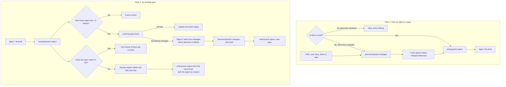

# Spec flow redesign: design

- **Date:** 2026-10-31
- **Status:** implemented on branch `writing-tech-specs-brief-only`
- **Related:** `discovering-tech-changes`, `writing-tech-specs`, two new skills (`reviewing-tech-specs`, `verifying-spec-facts`); the flow as users see it: [docs/skills/planning/flow.md](../skills/planning/flow.md)

## 1. Intent and why

Today the spec flow is `discovering-tech-changes` -> `writing-tech-specs`. Three problems came up while using it:

1. **The spec is tied to the code.** P3 puts an Assumptions section in the spec with code facts (functions, keys, commits, dates). A spec should hold the "what": the business rule survives a change of language or implementation (Node to Rust, Java to Python), so a migration is a planning exercise, not reverse engineering. The "how" (code facts, their dates and how to re-verify them) belongs to discovery, in the brief.
2. **There is no way to review a spec someone else wrote.** Review was removed from `writing-tech-specs` (one responsibility per skill) and has no home yet.
3. **Old specs go stale.** A spec implemented weeks after it was written may rest on facts that are no longer true (ITV-813: two PRs changed the code a central decision depended on; ITV-551: an endpoint the spec relied on was retired). Checking that needs the code, and no skill does it.

Plus one gap: the brief lives only in the chat context. It is local (not uploaded), but it must be a file so other skills can read it.

## 2. Goals, non-goals, anti-goals

**Goals**
- One responsibility per skill, loaded on demand, so the agent is not confused by mixed workflows and the context stays small.
- There is always a brief, and only `discovering-tech-changes` creates one.
- The spec holds the "what"; the brief holds the "how" and its dates.
- Only the skills whose job needs the code read it (`discovering-tech-changes`, `verifying-spec-facts`). Writing and reviewing a spec never read code.
- An existing spec can be reviewed; its brief's facts re-verified when old; and the spec rewritten when needed, without manual steps the flow can do itself.
- Briefs are files in one place outside all repositories, so a feature spanning several repos (backend, front) has one brief.

**Non-goals**
- Changes during implementation or code review by LT, PM or dev (unchanged out of scope).
- Publishing briefs (Confluence, Jira). They stay local.
- Changing how `discovering-tech-changes` does discovery (its steps stay as they are).

**Anti-goals**
- A skill that does two jobs with two procedures (rejected: a re-verification depth inside `discovering-tech-changes`).
- Two skills that produce briefs (rejected: re-verification producing a brief).
- A spec that names files, functions, keys or commits, or carries verification dates.
- Writing anything into the user's repositories.
- Rules (P1-P9) drifting apart between `writing-tech-specs` and `reviewing-tech-specs`.
- Leaving to the user by hand a step the flow can do (for example, refreshing dates after a clean re-verification).

## 3. The four skills

| Skill | Single responsibility | Reads code | Input | Writes |
|---|---|---|---|---|
| `discovering-tech-changes` (changed: saves the brief) | Produce the brief | Yes | FRD, user story, ticket or idea | The brief in `~/.tech-specs/<feature>/` |
| `writing-tech-specs` (changed: P3, input) | Write the spec from a brief | No | A brief; optionally a review report | The spec |
| `reviewing-tech-specs` (new) | Check a spec against P1-P9 and its brief's age | No | A spec and its brief | A review report |
| `verifying-spec-facts` (new; name tentative) | Check the brief's facts against today's code | Yes | A brief whose facts the review flagged as old | The brief's dates, or a report of what changed |

All four are manual-only (repo convention).

## 4. Flows



**Flow 1** is unchanged in shape: `writing-tech-specs` writes only from a brief and stops when there is none and the discovery is declined.

**Flow 2** has three outcomes, which can combine:
- **Facts changed** (`verifying-spec-facts` finds a fact no longer holds): it writes a report (which fact, what it is today, which spec decisions depend on it). The flow goes back to the start: `discovering-tech-changes` makes a new brief, then `writing-tech-specs` a new spec. Re-verification never produces a brief.
- **Facts hold**: `verifying-spec-facts` updates the verification dates in the brief (a local file). The spec has no dates, so nothing else changes and nothing is done by hand.
- **Form fails** (a P1-P9 rule fails but facts are current): `reviewing-tech-specs` writes a report; `writing-tech-specs` rewrites the spec from the same brief, using the report as context for what to fix. No new discovery.

## 5. The what and the how (P3 change)

The spec's Assumptions section becomes a section of today's behavior and dependencies (exact heading left to the builder).

- **In the spec:** observable facts about today ("today a conversation notifies every assigned agent"; "the log-code catalog already has values in use; new ones are assigned at implementation"), platform limits, design version, and each decision linked to the facts it depends on, saying if they are changing in other work. No code identifiers and no verification dates.
- **Only in the brief:** files, functions, keys, commits, verification dates, re-verify commands.
- **Why keep the section at all:** the team's evidence (`references/content.md`, P3) shows the failure was a decision depending on something nobody saw change. Behavior-level dependencies keep that warning without tying the spec to an implementation.
- The age check ("older than ~3 weeks") moves out of `writing-tech-specs` into `reviewing-tech-specs`, and reads the brief's dates. P3 and "Before freezing" item 3 change to match.
- The before→after examples in `references/content.md` (P3) that show code identifiers or dates in Assumptions must be rewritten at behavior level.

## 6. Where briefs live

```text
~/.tech-specs/
  2026-10-31-mute-conversation/
    brief.md                ← discovering-tech-changes (dates updated by verifying-spec-facts)
    review-2026-11-20.md    ← reviewing-tech-specs
    verify-2026-11-20.md    ← verifying-spec-facts, only when a fact changed
```

- One folder per feature: `YYYY-MM-DD-<short-slug>`, so two features never collide and backend and front share one brief.
- A new discovery after a failed re-verification writes a new brief in the same folder (keeping the old one is left to the builder: rename with date, or a dated file name).
- Reports go in the same folder, so the history of the change is visible. Whether reports are also shown in chat is left to the builder.
- The spec is not stored there; it lives wherever the team publishes it.
- Briefs are read only from `~/.tech-specs/` (the user's own workflow always has a brief there). `discovering-tech-changes` drops "Confluence on request" for the brief.
- Repositories stay read-only: the folder is outside all of them, so no working-tree exception and no self-ignoring `.gitignore` are needed (that trick, from superpowers' `.superpowers/sdd/`, is for folders inside a repo).
- Rule wording for `AGENTS.md` and the skills: skills never write to the user's repositories; they write only under `~/.tech-specs/`.

## 7. Keeping shared parts in sync

Each skill stays self-contained (repo convention: no shared files across skills). The duplicated part is guarded by a test:

- **Rules P1-P9** are identical in `writing-tech-specs` and `reviewing-tech-specs`. A test in `tests/` fails if the rule lines differ. Changing a rule means changing both and running RED/GREEN on both.
- `verifying-spec-facts` reads the brief's "how it works today" section (facts, dates, re-verify commands) by the section name in `discovering-tech-changes`' `brief-template.md`. A test fails if that name changes in the template and not in `verifying-spec-facts`.

## 8. Order of work

Each step follows "Changing a skill" / "Adding a skill" in `AGENTS.md` (scenario, RED, edit, GREEN, results recorded). Tests must point `~/.tech-specs/` at a scratch directory, never the real one.

1. **`writing-tech-specs`**: P3 as behavior with no code or dates; read the brief from `~/.tech-specs/`; accept a review report as context for a rewrite; drop the age check. First, because it defines what the spec holds, which the review reads.
2. **`discovering-tech-changes`**: save the brief in `~/.tech-specs/<feature>/` and say where; no Confluence for the brief.
3. **`reviewing-tech-specs`** (new): P1-P9 copied from `writing-tech-specs`; review rules (read-only, cite the spec's words, verdict, do not invent defects); age check on the brief's dates; write the review report; rule-sync test. The `review-seeded-spec` scenario and `fixtures/seeded-spec.md` removed on 2026-10-30 are in git history (`1821f28^`) and can be restored here, updated to the new P3.
4. **`verifying-spec-facts`** (new): re-verify the flagged facts against today's code, check surroundings (work in flight, contracts); if all hold, update the brief's dates; if not, write the report and point to `discovering-tech-changes`. Section-name test.
5. **`AGENTS.md`, README and docs**: the read-only rule with the `~/.tech-specs/` exception, the new skills in the planning table, `docs/skills/planning/flow.md` marked as implemented.

## 9. Decisions and what is left to the builder

**Decided in conversation (2026-10-31)**
- Re-verification is a separate skill, not a depth of `discovering-tech-changes` (one responsibility per skill; less context).
- Re-verification does not produce a brief; a changed fact sends the flow back to `discovering-tech-changes`.
- A clean re-verification updates the brief's dates automatically.
- A form failure rewrites the spec from the same brief, with the review report as context.
- Briefs live in `~/.tech-specs/`, one folder per feature, and are read only from there.

**Builder's calls (decided by the designer, can be revisited)**
- `verifying-spec-facts` called without a review report that flags facts: it asks for the report and, if there is none, points to `/reviewing-tech-specs` first. It does not run the age check itself.

**Left to the builder**
- Exact heading of the today's-behavior section, and its wording in P3 and checklist item 3.
- The slug rule for feature folders and how a skill asks for or derives the folder.
- Format and file names of the review and verification reports.
- What happens to the old brief when a new discovery writes a new one.
- Final name of `verifying-spec-facts`.
- Exact procedure and checkpoints of `verifying-spec-facts`, within: take the flagged facts, verify each against today's code, surroundings, then dates or report.
