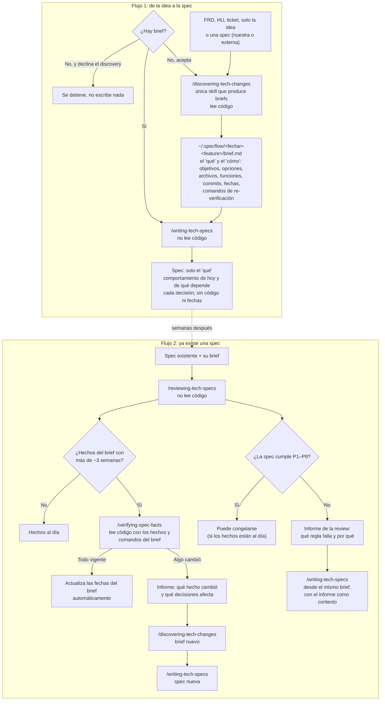

# Flujo de planning: de la idea a la spec, y de vuelta

[English](flow.md) | **Español**

Cómo trabajan juntas las skills de planning. Diseño y razones: [docs/plans/2026-10-31-spec-flow-redesign-design.md](../../plans/2026-10-31-spec-flow-redesign-design.md).



## Las cuatro skills

| Skill | Hace | Lee código | Escribe |
|---|---|---|---|
| `discovering-tech-changes` | Produce el brief | Sí | El brief en `~/.specflow/` |
| `writing-tech-specs` | Escribe la spec desde un brief | No | La spec, y una copia local `spec.md` |
| `reviewing-tech-specs` | Revisa la spec contra P1–P9 y la antigüedad del brief | No | Informe de la review |
| `verifying-spec-facts` | Comprueba los hechos del brief en el código de hoy | Sí | Las fechas del brief, o un informe de qué cambió |

## La carpeta specflow

Todo lo que escriben las skills vive en `~/.specflow/` (oculta), una carpeta por feature:

```text
~/.specflow/
  <YYYY-MM-DD>-<slug>/                 una carpeta por feature
    brief.md                           discovering-tech-changes
    brief-superseded-<YYYY-MM-DD>.md   un brief anterior
    spec.md                            writing-tech-specs: copia local de la spec
    spec-superseded-<YYYY-MM-DD>.md    una spec anterior
    review-<YYYY-MM-DD>.md             reviewing-tech-specs
    verify-<YYYY-MM-DD>.md             verifying-spec-facts, solo si un hecho cambió
    repos.md                           reservado: repositorios de la feature
    plan-<repo>.md                     reservado: un plan por repositorio
    progress-<repo>.md                 reservado: un registro de avance por repositorio
```

- Carpeta de la feature: `<YYYY-MM-DD>-<slug>`, la fecha en que se creó; un slug de 2 a 5 palabras en minúsculas unidas por `-`, confirmado contigo. `<repo>` es el nombre de la carpeta del repositorio (por ejemplo `atom`, `atom-ui`).
- Nada se sobrescribe. Una skill que escribe un archivo que ya existe renombra primero el anterior a `<nombre>-superseded-<YYYY-MM-DD>.md` (la fecha escrita dentro del archivo anterior, o si no, su fecha de modificación; `-2`, `-3`... si ese nombre existe). Hoy aplica a `brief.md` y `spec.md`.
- Los informes tampoco se sobrescriben: un segundo informe el mismo día es `review-<YYYY-MM-DD>-2.md`, luego `-3`... "El más reciente" es la fecha más nueva y luego el sufijo más alto como número (sin sufijo cuenta como 1).
- `spec.md` empieza con `Published: <link o not published yet>` y `Copy date: <YYYY-MM-DD>`. `reviewing-tech-specs` revisa la spec que indicas; si no nombras ninguna, usa el `spec.md` de la carpeta y dice su origen y su fecha. Nunca lo escribe.
- Ninguna skill lee `*-superseded-*`.
- ¿Vienes del nombre anterior de la carpeta? Ejecuta una vez: `mv ~/.tech-specs ~/.specflow`. Si existen las dos carpetas, nada se une por ti.

## Reglas que atraviesan el flujo

- Siempre hay un brief, y solo `discovering-tech-changes` lo crea.
- La spec guarda el "qué", para personas, y perdura; el brief guarda el "qué" y el "cómo" con evidencia del código y fechas, para el agente. La spec sobrevive a un cambio de lenguaje o de implementación.
- Una spec puede ser la entrada de discovery. Una spec externa siempre se reescribe con `writing-tech-specs` desde el brief nuevo antes de planear, para que toda spec que llega a planear tenga el formato del equipo; una spec de este flujo se reescribe cuando el brief la corrige.
- Las skills nunca escriben en tus repos. Solo escriben en `~/.specflow/`, una carpeta por feature, así un cambio que toca backend y front tiene un solo brief.
- Las reglas P1–P9 están copiadas en `writing-tech-specs` y `reviewing-tech-specs`; un test falla si las copias difieren.
- Cada skill la inicias tú; ninguna se ejecuta sola.
