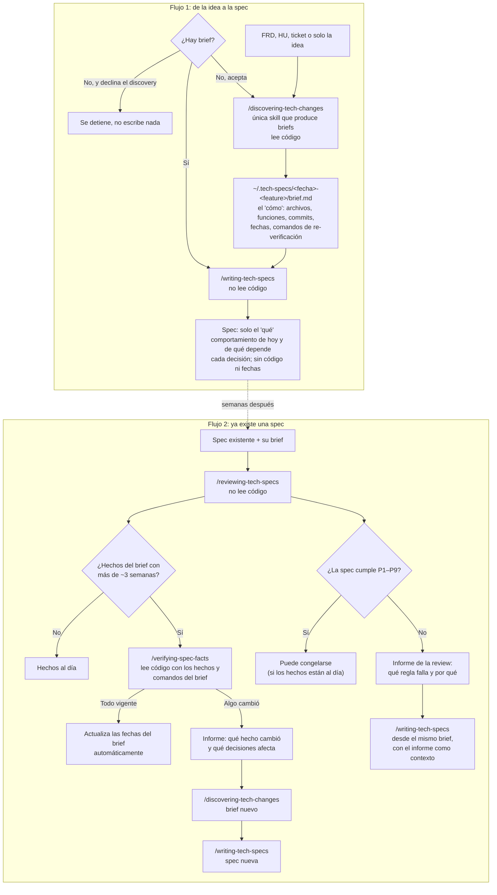

# Flujo de planning: de la idea a la spec, y de vuelta

[English](flow.md) | **Español**

Cómo trabajan juntas las skills de planning. Diseño y razones: [docs/plans/2026-10-31-spec-flow-redesign-design.md](../../plans/2026-10-31-spec-flow-redesign-design.md).

## Las cuatro skills

| Skill | Hace | Lee código | Escribe |
|---|---|---|---|
| `discovering-tech-changes` | Produce el brief | Sí | El brief en `~/.tech-specs/` |
| `writing-tech-specs` | Escribe la spec desde un brief | No | La spec |
| `reviewing-tech-specs` | Revisa la spec contra P1–P9 y la antigüedad del brief | No | Informe de la review |
| `verifying-spec-facts` | Comprueba los hechos del brief en el código de hoy | Sí | Las fechas del brief, o un informe de qué cambió |

## Reglas que atraviesan el flujo

- Siempre hay un brief, y solo `discovering-tech-changes` lo crea.
- El "qué" va en la spec; el "cómo" y sus fechas, en el brief. La spec sobrevive a un cambio de lenguaje o de implementación.
- Las skills nunca escriben en tus repos. Solo escriben en `~/.tech-specs/`, una carpeta por feature, así un cambio que toca backend y front tiene un solo brief.
- Las reglas P1–P9 están copiadas en `writing-tech-specs` y `reviewing-tech-specs`; un test falla si las copias difieren.
- Cada skill la inicias tú; ninguna se ejecuta sola.
