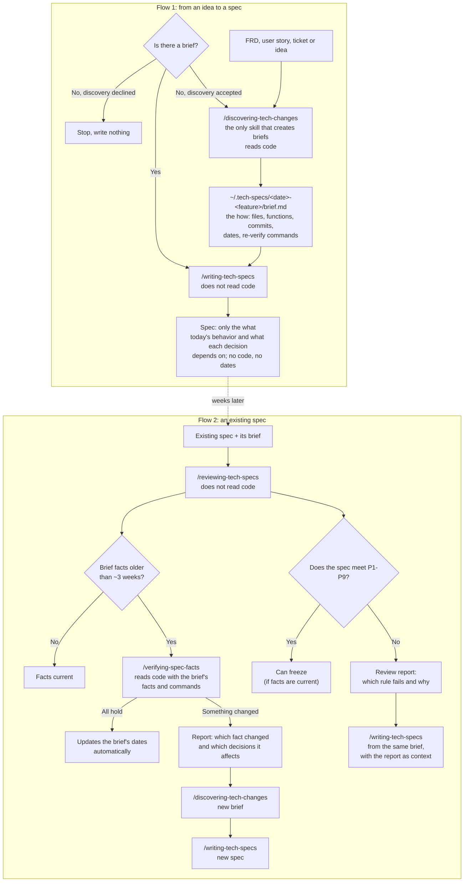

# Planning flow: from an idea to a spec, and back

**English** | [Español](flow.es.md)

How the planning skills work together. Design and reasons: [docs/plans/2026-10-31-spec-flow-redesign-design.md](../../plans/2026-10-31-spec-flow-redesign-design.md).

## The four skills

| Skill | Does | Reads code | Writes |
|---|---|---|---|
| `discovering-tech-changes` | Produces the brief | Yes | The brief in `~/.tech-specs/` |
| `writing-tech-specs` | Writes the spec from a brief | No | The spec |
| `reviewing-tech-specs` | Checks the spec against P1-P9 and the brief's age | No | A review report |
| `verifying-spec-facts` | Checks the brief's facts against today's code | Yes | The brief's dates, or a report of what changed |

## Rules across the flow

- There is always a brief, and only `discovering-tech-changes` creates one.
- The "what" goes in the spec; the "how" and its dates go in the brief. A spec survives a change of language or implementation.
- Skills never write to your repositories. They write only under `~/.tech-specs/`, one folder per feature, so a change across backend and front has one brief.
- Rules P1-P9 are copied in `writing-tech-specs` and `reviewing-tech-specs`; a test fails if the copies differ.
- You start each skill yourself; none runs implicitly.
